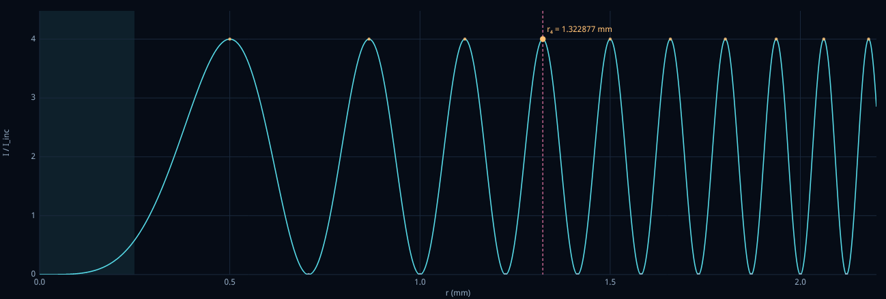
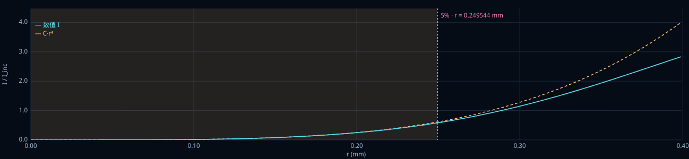
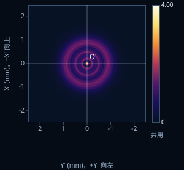
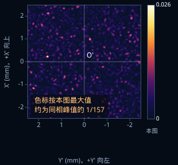
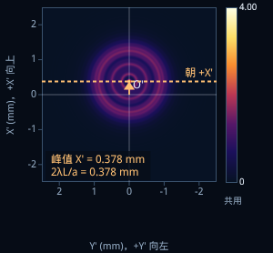
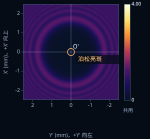

# 圆孔衍射 · 第13章研讨题第1题

本报告与精简页 [`submit.html`](../submit.html) 是同一次计算：λ = 500 nm，L = 50 cm。轴上曲线用标准档径向积分。四张二维图在圆孔上取子光源，对观察屏每个点把复振幅直接加起来。图是该页算完后导出的。

## 1. 模型与方法

波长 λ = 500 nm，衍射屏到观察屏 L = 50 cm，入射振幅 A = 1（实数，孔内均匀）。轴上半径从 0 扫到 2.2 mm。页面不能改参数。第一问用 `Diffraction.PRECISION.standard`：面板光程差 ≤ λ/20，Gauss–Legendre 8 点，半径采样 N_r = 4000，只调用 `computeQ1`。

积分是第一类瑞利–索末菲：

U(P) = (1/(iλ)) ∬ A · t · (L/R) · e^{ikR}/R dx dy，I = |U|²

t 在透光部分为 1、在不透明部分为 0。R 是面元到观察点的距离，倾斜因子 L/R 和球面波 1/R 都保留。先把各面元的复振幅加起来，再取模平方，不能先对光强做面积平均。略去严格核中的 (1 − 1/(ikR))，相对大小约 1/(kL) = 1.6×10⁻⁷。

第二问把同一个积分写成圆孔上的求和，R 仍是精确距离，没有旁轴近似：

U(X′,Y′) = (d²/(iλ)) Σ_j t_j · L · e^{ik R_j} / R_j²，R_j = √[(X′−x_j)² + (Y′−y_j)² + L²]，I = |U|²

子光源是边长为 d 的小方块，用中心一个点代替，复振幅乘面积 d² 和透过率 t_j。只保留孔内的点，x² + y² ≤ a²，a 取第一问的 r₄。同相圆孔 t_j = 1。沿 X 的线性相位 t_j = exp(i·8π(x+a)/(2a))。随机相位每个点一个独立相位 φ = 2π Hash(种子, m, n)，m、n 是网格下标（x = md，y = nd），种子 20261111。

d 由观察区角点决定，并且尽量稀疏。孔内离角点最远的横向距离是 ρ_max = a + √2·W/2，W = 5 mm。沿这条方向，相邻两源的光程差上界是 (ρ_max/R)·d，R = √(ρ_max²+L²)。令上界等于 λ/10，取允许的最大间距：d = (λ/10)·R/ρ_max = 5.146 μm。不把这个间距再放宽。8π 的入射相位写在 t_j 里，四种图用同一个 d。网格上轴向相邻两点到角点的实际最大 |ΔR| 是 39.31 nm，即 λ/12.72，比一阶上界 λ/10 小，因为最坏方向往往不落在网格轴上。

观察屏单独取点，不必和源用同一个间距。视场是以 O′ 为中心的 5 mm × 5 mm。随机相位散斑大约 λL/(2a) ≈ 94 μm，屏间距要明显小于它，这里取 25 μm，一边 201 个点。孔内实际有 N = 207585 个子光源。一张图要把 N×201² = 8.387×10⁹ 对复振幅加起来。同相、线性和随机各算一遍；圆屏由同相那一遍的复振幅相减得到，不再加一遍。每次打开页面都重新计算。

数值上先提出公共相位 e^{ikL}，累加约化场 U′ = U e^{−ikL}（|U′|² = |U|²），相位写成 k(R−L) = kρ²/(R+L)。归一化是 I/I_inc = |U|²/|A|²。A = 1，所以 I_inc = 1。时谐因子取 e^{−iωt}，相位延迟 φ 表示复振幅乘 e^{+iφ}。

不透明圆屏不在孔外取点。圆屏外面是无限大的开放区域，有限个子光源盖不住。无遮挡时约化场 U′ = 1，所以 U′_屏 = 1 − U′_孔。这是复振幅相减，不是光强相减。

光沿 +z，从孔面 z = 0 到观察屏 z = L。孔面坐标 (X, Y)，观察屏 (X′, Y′)，原点在轴上。+X 与 +X′ 向上；(X, Y, z) 是右手系，迎着光看时 +Y、+Y′ 向左。下面的二维图按这个方向画：竖直轴是 X′，左边是 +Y′。

| 采样 | 判据 | 实际间距 | 相邻光程或相位 |
|---|---|---|---|
| 轴上径向积分 | 面板 ≤ λ/20 | h = 5.682 μm，GL 8，N_r = 4000 | 相邻节点 4.59 nm（λ/109） |
| 圆孔子光源 | 角点光程差上界 = λ/10，尽量稀疏 | d = 5.146 μm，N = 207585 | 一阶上界 50.00 nm（λ/10），轴向相邻实际 39.31 nm（λ/12.72） |
| 观察屏 | 5 mm × 5 mm，间距 ≤ 25 μm | 201×201，d = 25.00 μm | 半宽 ±2.500 mm，散斑约 94 μm |
| 每一张图的加法 | 观察点 × 子光源 | 8.387×10⁹ 次 | 同相、线性、随机各一遍；圆屏用 U′ 相减 |

对照时用完整版传播内核自己的源采样（同一间距、同一 Hash(种子, m, n)、同一边缘权重），再对若干相同观察点做直接求和。同相、线性、随机、圆屏的 max|ΔI| 分别是 4.7×10⁻⁷、3.7×10⁻⁷、5.7×10⁻¹⁰、2.4×10⁻⁷。页面上的四张图用的是孔内网格点，不读那次对照。在无头 Chrome、4 个 Worker 上，同相、线性、随机各用了 101 s、99 s、106 s。

只做一组网格加密。在标准档已经定位的第 4 个极大附近，把径向求积加密后再解 dI/dr = 0。差相对于最密的一档。三档给出的 r₄、I₄ 在所引用的位数上相同，Δr 远小于 0.001 nm。

| 求积 | h (μm) | r₄ (mm) | I₄ | Δr (nm) | ΔI |
|---|---|---|---|---|---|
| 标准档 λ/20，GL 8（本页采用） | 5.682 | 1.3228768035 | 3.999986000 | 1.06×10⁻⁶ | 9.77×10⁻¹⁵ |
| 加密 λ/80，GL 16 | 1.420 | 1.3228768035 | 3.999986000 | 0 | −1.33×10⁻¹⁴ |
| 再加密 λ/160，GL 16 | 0.710 | 1.3228768035 | 3.999986000 | 0 | 0 |

## 2. 轴上结果

孔变大以后，边缘光程每增加约 λ/2，就多一条半波带，轴上光强随 r² 近似等间隔地起伏。菲涅耳数 N_F = r²/(λL) 接近奇数时为极大，接近偶数时为极小。0–2.2 mm 里有 10 个极大和 9 个极小，相邻极大之间有 9 个完整振荡周期。相邻极大的 Δ(r²) 接近 2λL = 0.500 mm²，所以画在 r 轴上时，振荡越往外越密。

半径很小时，孔内各子波的传播相位几乎相同，复振幅与孔面积成正比，于是 U ∝ r²，I ∝ r⁴。系数 C = I(r_s)/r_s⁴ 在 r_s = 10⁻³√(λL) 处由数值积分得到，下图虚线是 C·r⁴。相对偏差 ε(r) = |I / (C r⁴) − 1|。**5% 是自行选定的 r⁴ 近似判据**，不是题目规定的唯一边界。允许偏差 5% 时，从 r = 0 起 ε 连续不超过 5% 的最大半径为 r ≤ 0.2495438957 mm。

极值先在 I(r) 采样上检出，再在相邻采样之间求 dI/dr = 0。第 4 个极大是 r₄ = 1.322877 mm（全精度 1.3228768035 mm），I₄/I_inc = 3.999986。Δ(r²) 是与上一个同类极值的差。

| 序号 | r (mm) | r² (mm²) | N_F | I/I_inc | Δ(r²) (mm²) |
|---|---|---|---|---|---|
| 极大 1 | 0.500000 | 0.2500 | 1.0000 | 3.999998 | — |
| 极小 1 | 0.707107 | 0.5000 | 2.0000 | 1.00×10⁻¹² | — |
| 极大 2 | 0.866026 | 0.7500 | 3.0000 | 3.999994 | 0.5000 |
| 极小 2 | 1.000000 | 1.0000 | 4.0000 | 4.00×10⁻¹² | 0.5000 |
| 极大 3 | 1.118035 | 1.2500 | 5.0000 | 3.999990 | 0.5000 |
| 极小 3 | 1.224746 | 1.5000 | 6.0000 | 9.00×10⁻¹² | 0.5000 |
| **极大 4** | **1.322877** | **1.7500** | **7.0000** | **3.999986** | **0.5000** |
| 极小 4 | 1.414215 | 2.0000 | 8.0000 | 1.60×10⁻¹¹ | 0.5000 |
| 极大 5 | 1.500002 | 2.2500 | 9.0000 | 3.999982 | 0.5000 |
| 极小 5 | 1.581141 | 2.5000 | 10.0000 | 2.50×10⁻¹¹ | 0.5000 |
| 极大 6 | 1.658315 | 2.7500 | 11.0000 | 3.999978 | 0.5000 |
| 极小 6 | 1.732053 | 3.0000 | 12.0000 | 3.60×10⁻¹¹ | 0.5000 |
| 极大 7 | 1.802779 | 3.2500 | 13.0000 | 3.999974 | 0.5000 |
| 极小 7 | 1.870832 | 3.5000 | 14.0000 | 4.90×10⁻¹¹ | 0.5000 |
| 极大 8 | 1.936495 | 3.7500 | 15.0001 | 3.999970 | 0.5000 |
| 极小 8 | 2.000004 | 4.0000 | 16.0001 | 6.40×10⁻¹¹ | 0.5000 |
| 极大 9 | 2.061557 | 4.2500 | 17.0001 | 3.999966 | 0.5000 |
| 极小 9 | 2.121325 | 4.5000 | 18.0001 | 8.10×10⁻¹¹ | 0.5000 |
| 极大 10 | 2.179455 | 4.7500 | 19.0001 | 3.999962 | 0.5000 |

## 3. 二维结果

四张图的孔径半径都取 r₄ = 1.322877 mm，视场 5 mm × 5 mm，中心在 O′。同相圆孔、线性相位和圆屏共用色标（上限是这三张直接叠加图的最大光强，4.00）；随机相位按本图自己的最大值上色。

孔内 t_j = 1。传播光程仍然让子波干涉，屏上是以 O′ 为中心的菲涅耳环。屏中心把 207585 个子光源加起来，I/I_inc = 3.999829，第一问径向积分的 I₄ = 3.999986。

每个子光源一个独立相位 φ = 2π Hash(20261111, m, n)，间距 d = 5.146 μm。这是一次实现，不是时间平均，换种子或换 d 都会换图样。本图最亮 I_max = 0.02552，约为同相峰值的 1/157。观察区平均光强 2.370×10⁻³，估计值 N(d²/λL)² = 2.329×10⁻³。

t_j = exp(i·8π(x+a)/(2a))，相位从孔的 −X 端到 +X 端增加 8π，延迟端在 +X。图样朝 +X′ 移动。几何预期 2λL/a = 0.378 mm（全精度 0.377964 mm）。Y′ = 0 剖面上用三点抛物线得到的峰值在 X′ = 0.378 mm（0.377728 mm），该处直接叠加 I/I_inc = 3.999767。几何偏移点上 I/I_inc = 3.999829。O′ 处 I/I_inc = 0.866，不再是极大。

同半径不透明圆屏不在孔外另取点。圆屏外面是无限大的开放区域，直接取点盖不住。**巴比涅关系是 U′_屏 = 1 − U′_孔**，不能写成光强相减。轴上留下泊松亮斑，I/I_inc = 0.999919。

## 4. 结论

在 λ = 500 nm、L = 50 cm 下，轴上 I(r) 从 0 到 2.2 mm 有 10 个极大和 9 个极小，相邻极大之间有 9 个完整振荡周期。小孔区用自行选定的 5% 判据，I 与 r⁴ 的相对偏差不超过 5% 一直维持到 r ≤ 0.2495438957 mm。第 4 个极大 r₄ = 1.322877 mm（1.3228768035 mm），I₄ = 3.999986。二维孔径就取这个半径，在孔内取 N = 207585 个子光源（d = 5.146 μm）：同相圆孔的屏中心 I = 3.999829；随机相位（种子 20261111）的平均光强是 2.370×10⁻³；沿 X 的 8π 线性相位使图样朝 +X′ 移动约 0.378 mm；不透明圆屏的泊松亮斑来自复振幅关系 U′_屏 = 1 − U′_孔，轴上 I = 0.999919，不是光强相减。
